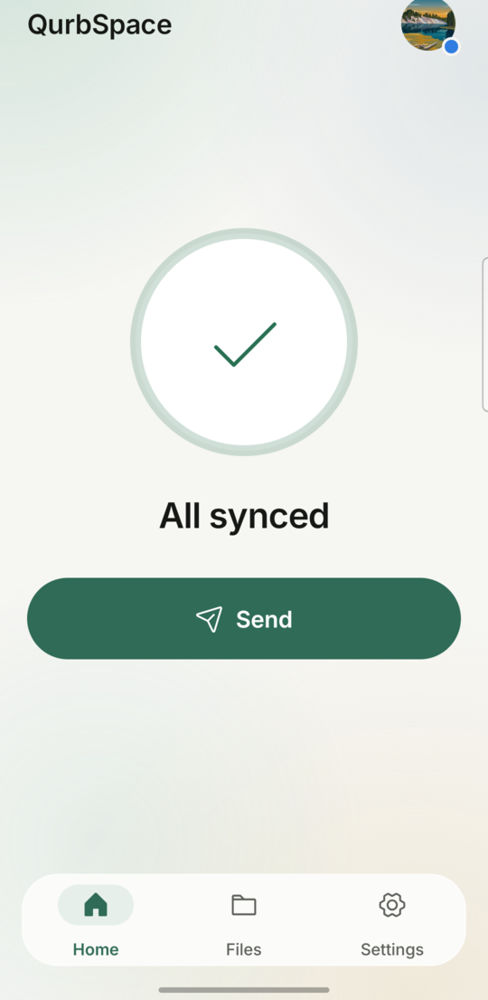
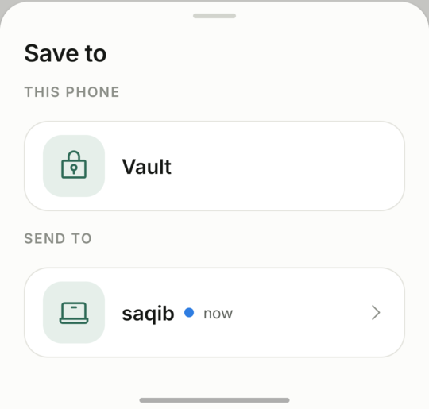

<h1 align="center">
  <picture>
    <source media="(prefers-color-scheme: dark)" srcset="docs/brand/readme-header-dark.png" />
    
  </picture>
</h1>

<p align="center"><b>Your phone and your computer, in sync, with nothing in between.</b></p>

QurbSpace keeps files, photo and WhatsApp backups moving between your own
devices: directly when they can reach each other, encrypted end to end, and
never stored on a server of ours. Your computer is your cloud.

> **Open beta.** It works every day between an Android phone and a Linux
> laptop. Read [what is not finished yet](#known-gaps) before trusting it with
> anything you cannot lose, and keep your own copy.

<!-- Screenshots: docs/screenshots/, taken on a Galaxy S23. -->
<p align="center">
  
  &nbsp;&nbsp;
  
</p>

## What it does

- **Sends** a file or photo from the phone to the computer, or back, in
  seconds on the same Wi-Fi.
- **Fast transfers at home**: a large file from the phone goes over a Wi-Fi
  link straight to the computer, about three times as fast as through
  the router, whenever nobody is using the computer (it is offline for the
  minute it takes). Android 13 or later, and a Linux or Windows computer.
- **Backs up** WhatsApp and the folders you choose from the phone to your
  computer, overnight while charging, instead of Google's 15 GB.
- **Opens your computer's folders from the phone**, from anywhere: browse,
  preview, download, restore.
- **Works from anywhere**: home Wi-Fi first, then directly across the
  internet, then through your own Google Drive if you turn it on, sealed so
  Google cannot read it.
- **Stays private**: every file is encrypted between your devices. Nothing
  passes through a server of ours; there is none.

## Get the beta

Pick your device; the download starts at once.

| Your device | Download | To install |
|---|---|---|
| **Android phone** (Android 8 or later) | [QurbSpace for Android](https://github.com/saqibsiddiq/QurbSpace/releases/latest/download/QurbSpace-android.apk) | Open the file, and allow installing from your browser when asked. Updates itself. |
| **Windows** 10 or 11 | [QurbSpace for Windows](https://github.com/saqibsiddiq/QurbSpace/releases/latest/download/QurbSpace-windows-setup.exe) | Run the installer. Tested on GitHub's Windows machines, not yet on a person's PC: tell us how it goes. |
| **Linux**: Ubuntu, Debian, Mint, Pop!_OS | [QurbSpace for Ubuntu and Debian](https://github.com/saqibsiddiq/QurbSpace/releases/latest/download/QurbSpace-linux.deb) | Open the file to install it. Does not update itself yet: download again for a new version. |
| **Linux**: any other (Fedora, Arch and the rest) | [QurbSpace for any Linux](https://github.com/saqibsiddiq/QurbSpace/releases/latest/download/QurbSpace-linux.AppImage) | Allow it to run (right click, Properties, Permissions), then open it. Updates itself. |

Not sure which Linux you have? The second Linux download works on all of them.

**A warning when you install is expected.** QurbSpace is new and comes from
here rather than an app store, so:

- **Android**: Google Play Protect may say *This app may be harmful* or ask to
  scan it. Tap **More details**, then **Install anyway**. It warns because the
  app can install its own updates, which is how it updates itself. On a
  Samsung phone, *Auto Blocker* (Settings, Security and privacy) may need to
  be off while you install.
- **Windows**: *Windows protected your PC*. Tap **More info**, then **Run
  anyway**. The installer is not signed yet.

The code is all here to read, and each release is built from it by GitHub.

Then:

1. Open QurbSpace on the computer: it sets itself up. Go to **Devices → Add a
   device**.
2. Open QurbSpace on the phone and join with the **QR code or the six
   digits** the computer shows.
3. On the phone, tap **Tap to connect**. While it says *Connected* in your
   notifications, anything the computer sends arrives in seconds; tap the
   notification to disconnect.

Found something wrong? **[Report it](https://github.com/saqibsiddiq/QurbSpace/issues/new/choose).**
*Save a report* (Settings → Advanced) saves a file you can attach.

## Known gaps

Stated plainly, because a backup app is only worth what it can be trusted
with:

- **Deleting is for good.** There is no Recently deleted: a file deleted on
  one device is deleted on all of them.
- **Restoring a whole WhatsApp backup to a new phone has not been proven**
  end to end. Restoring single files and folders has.
- **Windows** is tested automatically on GitHub's machines (installing,
  starting, two devices syncing and sending), not yet on a person's PC, and
  its window not yet at all. There is **no iPhone or
  Mac** version.
- **Google Drive** is optional. A file waiting there reaches the phone at its
  next sync: Drive cannot wake a phone.
- Tested on a Galaxy S23 and an OPPO CPH2363 (Jio), and one Linux laptop.
  Other phones, carriers and routers are what this beta is for.

More: what exists and how far each part is checked, [docs/features.md](docs/features.md);
what testers are told and what is done before each release, [docs/beta.md](docs/beta.md).

## Privacy and security

What leaves your devices, and to whom: [PRIVACY.md](PRIVACY.md). Found a
security problem? Please report it privately: [SECURITY.md](SECURITY.md).

---

## For developers

### Start here

**[docs/CODEBASE.md](docs/CODEBASE.md)** has everything needed to understand this
project from scratch. No prior context assumed.

Then, depending on what you want:

| you want | read |
|---|---|
| what it can do today | [docs/features.md](docs/features.md) |
| the vocabulary | [docs/glossary.md](docs/glossary.md) |
| what comes next, and what the product brief asks | [docs/product-plan.md](docs/product-plan.md) |
| the phases, and the honest risks | [docs/roadmap.md](docs/roadmap.md) |
| the full target design | [docs/architecture.md](docs/architecture.md) |
| why a particular choice was made | [docs/decisions/](docs/decisions/) |
| what each phase produced and measured | [docs/phases/](docs/phases/) |
| how to try it on your own hardware | [docs/trying-it.md](docs/trying-it.md) |

### Layout

```
docs/           documentation: start with CODEBASE.md
crates/         the engine, the program, the desktop window, the services
android/        the Android app, a thin Kotlin layer over the FFI
packaging/      installing: an Arch package, an install script, server units, Windows' README
scripts/        building for Android, a release, generating bindings and icons, the desktop smoke test
experiments/    throwaway spikes, clearly marked as such
website/        the website (Next.js), in the apps' design, independent of the engine
```

The split between `crates/` and `experiments/` is deliberate. Experimental code
may cut corners provided its README says which. Code in `crates/` is meant to
last. Nothing migrates silently between them.

### Building it yourself

From a release (`./scripts/release.sh` builds one into `dist/`; what each file
is for, and what it has run on, is [docs/releasing.md](docs/releasing.md)):
the `.deb` on Debian, Ubuntu and their kind, the `.rpm` on Fedora and openSUSE
Tumbleweed, both for glibc 2.34 and later; the Arch package; the static
`qurb` alone on any Linux; the `.apk` on any Android phone from 8.0.

From this checkout, on Arch (the window, the tray icon and the command line):

```bash
cd packaging/arch && makepkg -si
```

Anywhere else, for this user only:

```bash
cargo build --release -p qurb-cli -p qurb-tray -p qurb-desktop
./packaging/install.sh
```

Then open qurb from the applications menu: it sets the device up, with nothing
to write down, and pairs another device by QR code or six digits. From a
terminal instead:

```bash
qurb init                  # a new key, in ~/qurb/Shared; nothing to write down
qurb pair                  # on it: shows a code and six digits
qurb join <code or digits> # on the other device: takes the key and pairs
qurb run                   # on both
```

The Android app: `./scripts/android-app.sh install`. Away from home the
devices meet through public Nostr relays, with nothing to set up
([decision 0087](docs/decisions/0087-quic-over-nostr-relays.md)). Step by
step, including the phone: [docs/trying-it.md](docs/trying-it.md).

To watch the whole system work in one process, servers included:

```bash
cargo run --release -p qurb-peer --example demo -- /tmp/device-a /tmp/device-b
```

### Building and testing

```bash
cargo build --release
cargo test --workspace
./scripts/desktop-smoke.sh     # the real window, driven end to end
```

The Phase 0 measurements (chunking throughput, boundary stability, NAT
classification) are in [experiments/phase0-spike](experiments/phase0-spike/)
and [docs/phases/phase-0-spike.md](docs/phases/phase-0-spike.md). `quictest
stun` there contacts public STUN servers, revealing your public IP to them as
any video-call client does.

## Licence

Either of [Apache-2.0](LICENSE-APACHE) or [MIT](LICENSE-MIT), at your option,
as `Cargo.toml` declares.
